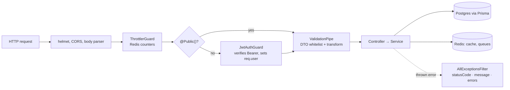
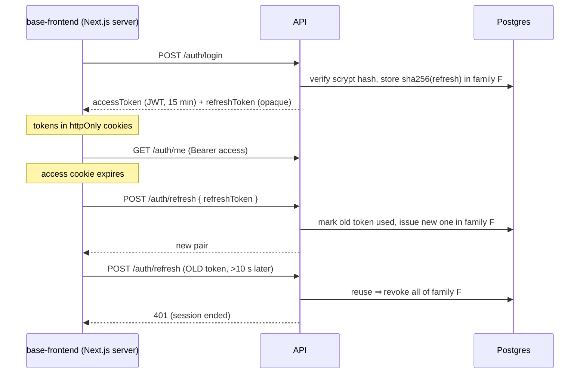
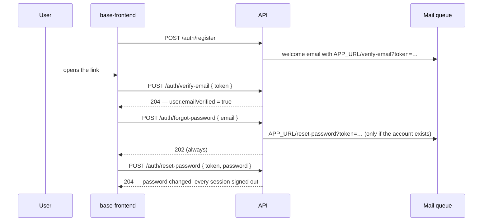

# Base Backend

Production-minded **NestJS starter kit**: NestJS 12 · Prisma 7 · PostgreSQL 18 · Redis 8 · BullMQ ·
Docker. It ships the auth API that [base-frontend](https://github.com/Konta1404/base-frontend)
(Next.js) expects, so the two repos together are a working full-stack app on day one. Fork it,
rename it, and start adding features.

**What you get out of the box**

- 🔐 **Auth** — email/password + Google sign-in, email verification, password reset,
  short-lived revocable JWT access tokens, rotating refresh tokens with theft detection, routes
  private by default.
- 🗄️ **Database** — Prisma 7 with committed SQL migrations, typed client, dev seed.
- ⚡ **Redis** — read-through cache, rate limits shared across instances, BullMQ background jobs.
- 🛡️ **Hardening** — validated config (refuses example secrets in production), strict DTO
  validation, consistent error shape, helmet, per-account login throttling.
- 📈 **Observability** — request IDs, one structured log line per request (JSON in production),
  Prometheus metrics.
- 🐳 **Docker everywhere** — hot-reload dev stack, one-file full stack with the frontend, lean
  non-root production image with a separate migration step.
- ✅ **Quality gates** — Vitest unit + e2e (real Postgres/Redis, isolated test database), oxlint, Prettier, Husky, GitHub
  Actions CI, Swagger docs.

---

## Contents

1. [Quick start](#1-quick-start)
2. [Tech stack](#2-tech-stack)
3. [Project structure](#3-project-structure)
4. [How a request flows](#4-how-a-request-flows)
5. [Configuration](#5-configuration)
6. [Everyday commands](#6-everyday-commands)
7. [Recipes — building features](#7-recipes--building-features)
8. [Authentication in depth](#8-authentication-in-depth)
9. [Redis: cache, rate limits, jobs](#9-redis-cache-rate-limits-jobs)
   · [Observability](#observability-logs-request-ids-metrics)
10. [Testing](#10-testing)
11. [Code quality & CI](#11-code-quality--ci)
12. [Deployment](#12-deployment)
13. [Troubleshooting](#13-troubleshooting)
14. [Starting a new project from this kit](#14-starting-a-new-project-from-this-kit)
15. [Known limitations](#15-known-limitations)

---

## 1. Quick start

**Prerequisites:** Docker Desktop. (Node 24 only if you want to run things outside Docker.)

```bash
cp .env.example .env
docker compose up --build
```

| What       | URL / value                           |
| ---------- | ------------------------------------- |
| API        | http://localhost:4000                 |
| Swagger UI | http://localhost:4000/docs            |
| Health     | http://localhost:4000/health          |
| Metrics    | http://localhost:4000/metrics         |
| Postgres   | `localhost:5432` · user/pass/db `app` |
| Redis      | `localhost:6379`                      |
| Demo login | `demo@example.com` / `password123`    |

On every start the API container generates the Prisma client, applies pending migrations, seeds
the demo user, and starts Nest in watch mode. Edit a file in `src/` and it reloads.

### With the frontend (one command)

Clone [base-frontend](https://github.com/Konta1404/base-frontend) next to this repo
(`../base-frontend`), then:

```bash
docker compose -f docker-compose.fullstack.yml up --build
# or on macOS: double-click start-fullstack.command
```

Frontend on http://localhost:3000, talking to this API. `start-fullstack.command` stops old
stacks, checks ports, and — if you already run the frontend with `npm run dev` — starts only
Postgres, Redis and the API for it.

### Without Docker

```bash
npm install
# needs Postgres + Redis reachable via DATABASE_URL / REDIS_URL in .env
npm run db:deploy && npm run db:seed   # also run `npm run db:generate` after schema changes
npm run start:dev
```

---

## 2. Tech stack

| Concern        | Choice                                                | Notes                                           |
| -------------- | ----------------------------------------------------- | ----------------------------------------------- |
| Runtime        | Node 24, TypeScript, **ESM**                          | Relative imports end in `.js`                   |
| Framework      | NestJS 12 (Express)                                   |                                                 |
| Database       | PostgreSQL 18 + Prisma 7                              | `prisma-client` generator, `@prisma/adapter-pg` |
| Cache / queues | Redis 8 + ioredis 6 + BullMQ 6                        |                                                 |
| Auth           | `@nestjs/jwt` (HS256), opaque refresh tokens, scrypt  | `google-auth-library` for Google ID tokens      |
| Validation     | class-validator / class-transformer (DTOs), zod (env) |                                                 |
| Docs           | `@nestjs/swagger`                                     | `/docs`, off in production by default           |
| Tests          | Vitest + Supertest                                    | e2e against real Postgres and Redis             |
| Lint / format  | oxlint, Prettier, Husky + lint-staged                 |                                                 |

---

## 3. Project structure

```
prisma/
  schema.prisma              data model (User, RefreshToken, AuthToken)
  migrations/                committed SQL migrations — never edit an applied one
  seed.ts                    dev-only demo user
prisma.config.ts             Prisma CLI config (schema path, migrations, seed, DATABASE_URL)
src/
  main.ts                    bootstrap
  setup.ts                   HTTP pipeline (helmet, CORS, ValidationPipe, Swagger) — shared with e2e
  app.module.ts              wires modules + global guards (throttle → JWT) + error filter
  config/                    env schema (zod) and typed AppConfig
  prisma/                    PrismaService (global)
  redis/                     shared ioredis client, injected with the REDIS token (global)
  cache/                     CacheService: JSON cache with TTL, fails open (global)
  queue/                     BullMQ connection + default job options (global)
  common/
    decorators/              @Public, @CurrentUser, @CredentialRateLimit
    session-revocation.service.ts  revoked sessions in Redis → access tokens die on logout
    guards/jwt-auth.guard.ts verifies Bearer tokens on every non-public route
    filters/                 AllExceptionsFilter → { statusCode, message, errors? }
    throttle.ts              rate-limit config (per IP, or per IP+email on credential routes)
    redis-throttler.storage.ts
  auth/                      /auth/* — login/register, tokens, Google, scrypt,
                             AccountService (email verification, password reset)
  users/                     UsersService (+ cached profile), PATCH /users/me example
  mail/                      example queue: producer (MailService) + consumer (MailProcessor)
  health/                    /health (db + redis), /health/live
  observability/             JSON logger, request id + access log middleware, /metrics
  generated/prisma/          generated Prisma client — git-ignored, don't edit
test/                        e2e tests (*.e2e-spec.ts) + isolated test DB setup
docker-compose.yml           dev: db + redis + api (hot reload)
docker-compose.fullstack.yml dev: + base-frontend
docker-compose.prod.yml      production: db + redis + migrate (one-off) + api
Dockerfile                   deps → dev | build → runner
```

**Module rule of thumb:** infrastructure modules (`config`, `prisma`, `redis`, `cache`, `queue`)
are `@Global()` — inject their services anywhere. Feature modules (`auth`, `users`, `mail`, your
own) are not; import what you need and export what others need.

---

## 4. How a request flows



- **Routes are private by default.** Opt out with `@Public()`.
- **DTOs are strict:** unknown fields → 400 (`whitelist` + `forbidNonWhitelisted`).
- **Errors always look the same.** `message` is a user-safe string — base-frontend shows it
  verbatim. Validation errors also list everything in `errors`. Prisma `P2002` → 409,
  `P2025` → 404, anything unexpected → 500 with the stack in the logs only.

### How base-frontend calls this API

The browser never talks to port 4000. Next.js is a backend-for-frontend: server actions and
`/api/backend/*` route handlers call this API server-to-server and keep tokens in httpOnly
cookies.

```ts
// base-frontend — server components / actions
const projects = await api<Project[]>("/projects");
// base-frontend — client components (proxied with the user's token)
await fetch("/api/backend/projects", { method: "POST", body: JSON.stringify({ name }) });
```

That's why you won't see `:4000` in the browser's Network tab, and why CORS is off by default.

---

## 5. Configuration

All variables are validated at startup by [`src/config/env.ts`](src/config/env.ts); a bad value
stops the app with a readable message. Read them with `AppConfig.get("NAME")` — typed, never
`process.env`.

| Variable                                          | Default                            | Purpose                                                                                              |
| ------------------------------------------------- | ---------------------------------- | ---------------------------------------------------------------------------------------------------- |
| `NODE_ENV`                                        | `development`                      | `production` turns Swagger off by default                                                            |
| `PORT`                                            | `4000`                             |                                                                                                      |
| `DATABASE_URL`                                    | — (required)                       | Set automatically inside docker compose                                                              |
| `REDIS_URL`                                       | `redis://localhost:6379`           | Set automatically inside docker compose                                                              |
| `CACHE_TTL`                                       | `300`                              | Default cache TTL (s)                                                                                |
| `APP_URL`                                         | `http://localhost:3000`            | Frontend URL used in emailed links                                                                   |
| `EMAIL_VERIFICATION_TTL` / `PASSWORD_RESET_TTL`   | `86400` / `3600`                   | Lifetime (s) of emailed links                                                                        |
| `LOG_FORMAT`                                      | json in prod, else pretty          | `json` (one object per line) or `pretty`                                                             |
| `LOG_LEVEL`                                       | `log`                              | `error` · `warn` · `log` · `debug` · `verbose`                                                       |
| `LOG_CLIENT_IP`                                   | masked in prod, else full          | Client IP in request logs: `full`, `masked` (IPv4 /24, IPv6 /48) or `off`                            |
| `METRICS_ENABLED` / `METRICS_TOKEN`               | dev: on · prod: only with a token  | `/metrics`; a token (≥ 16 chars) requires Bearer auth. `METRICS_ENABLED=true` forces it on           |
| `JWT_SECRET`                                      | — (required, ≥ 32 chars)           | `openssl rand -base64 48`                                                                            |
| `JWT_ISSUER`                                      | `base-backend`                     | `iss` claim; rename per project                                                                      |
| `JWT_ACCESS_TTL`                                  | `900`                              | Access token lifetime (s), returned as `expiresIn`                                                   |
| `REFRESH_TOKEN_TTL`                               | `2592000`                          | Refresh token lifetime (s) — 30 days, matches the frontend                                           |
| `REFRESH_REUSE_GRACE`                             | `10`                               | Seconds a just-rotated refresh token is still accepted                                               |
| `GOOGLE_CLIENT_ID`                                | empty (disabled)                   | Same ID as the frontend; comma-separate several                                                      |
| `CORS_ORIGINS`                                    | empty (off)                        | Only if a browser calls the API directly                                                             |
| `TRUST_PROXY`                                     | `loopback, linklocal, uniquelocal` | Who may set `X-Forwarded-For` (hop count or subnets) — see [Client IPs](#client-ips-and-rate-limits) |
| `THROTTLE_TTL`                                    | `60`                               | Rate-limit window (s)                                                                                |
| `THROTTLE_LIMIT`                                  | `300`                              | Requests per window per IP                                                                           |
| `AUTH_THROTTLE_LIMIT`                             | `10`                               | Login/register/forgot-password attempts per window **per client IP + email**                         |
| `AUTH_IP_THROTTLE_LIMIT`                          | `30`                               | Same routes, per window **per client IP** across all emails                                          |
| `AUTH_ACCOUNT_FAILURE_LIMIT` / `_WINDOW`          | `100` / `3600`                     | **Failed** logins per account (any IP) per window before password login pauses                       |
| `SWAGGER_ENABLED`                                 | on outside production              | Force Swagger on/off                                                                                 |
| `POSTGRES_*`, `DB_PORT`, `REDIS_PORT`, `API_PORT` | see `.env.example`                 | Docker compose only                                                                                  |

**Production safety:** with `NODE_ENV=production` the app refuses to start if `JWT_SECRET` is an
example value or `DATABASE_URL` uses a default/weak password (`app`, `postgres`, …).

**Adding a variable:** add it to `envSchema` in `src/config/env.ts` (with a default if it's
optional), document it in `.env.example`, then `config.get("MY_VAR")`. If Docker needs it,
pass it through in the compose files.

---

## 6. Everyday commands

**Docker (dev).** If you started the full stack, add `-f docker-compose.fullstack.yml` after
`docker compose`.

| Task                       | Command                                                             |
| -------------------------- | ------------------------------------------------------------------- |
| Start / rebuild            | `docker compose up --build`                                         |
| Pick up new dependencies   | `docker compose up --build -V`                                      |
| Logs                       | `docker compose logs -f api`                                        |
| Shell in the API container | `docker compose exec api sh`                                        |
| New migration              | `docker compose exec api npm run db:migrate -- --name <name>`       |
| Prisma Studio              | `npm run db:studio` on your machine (uses `.env` → Docker Postgres) |
| psql                       | `docker compose exec db psql -U app app`                            |
| redis-cli                  | `docker compose exec redis redis-cli`                               |
| Stop                       | `docker compose down`                                               |
| Wipe database + Redis      | `docker compose down -v`                                            |

**npm scripts**

| Script                             | What it does                                                              |
| ---------------------------------- | ------------------------------------------------------------------------- |
| `start:dev` / `start:debug`        | Watch mode / watch + inspector on `:9229`                                 |
| `build` / `start:prod`             | Compile to `dist/` / run it                                               |
| `test` / `test:watch` / `test:cov` | Unit tests                                                                |
| `test:e2e`                         | e2e tests on an isolated `*_test` DB, see [Testing](#10-testing)          |
| `lint` / `typecheck` / `format`    | oxlint / `tsc --noEmit` / Prettier                                        |
| `db:generate`                      | Regenerate the Prisma client                                              |
| `db:migrate` / `db:deploy`         | Create+apply migration and regenerate client (dev) / apply pending (prod) |
| `db:seed` / `db:studio`            | Seed demo user / open Prisma Studio                                       |
| `bench:login`                      | Login throughput / latency against a running API                          |
| `smoke:prod`                       | Build and smoke-test the production compose stack in isolation (Docker)   |

---

## 7. Recipes — building features

### 7.1 Add a resource (CRUD) end to end

Example: user-owned **projects**. This exact code is tested against this kit.

**1. Model** — `prisma/schema.prisma`:

```prisma
model Project {
  id        String   @id @default(uuid(7)) @db.Uuid
  name      String
  ownerId   String   @map("owner_id") @db.Uuid
  createdAt DateTime @default(now()) @map("created_at") @db.Timestamptz(3)
  updatedAt DateTime @updatedAt @map("updated_at") @db.Timestamptz(3)

  owner User @relation(fields: [ownerId], references: [id], onDelete: Cascade)

  @@index([ownerId])
  @@map("projects")
}
// and on model User:  projects Project[]
```

Conventions: UUIDv7 ids, `snake_case` tables/columns via `@map`, `Timestamptz`, index every
foreign key.

**2. Migration**

```bash
docker compose exec api npm run db:migrate -- --name add_projects
```

Creates and applies `prisma/migrations/<timestamp>_add_projects/migration.sql` (commit it), then
regenerates the client. (Prisma 7's `migrate dev` no longer generates the client by itself —
the script does both.)

**3. DTOs** — `src/projects/dto/project.dto.ts`:

```ts
import { ApiProperty, PartialType } from "@nestjs/swagger";
import { Transform } from "class-transformer";
import { IsString, Length } from "class-validator";

export class CreateProjectDto {
  @ApiProperty({ example: "Website redesign" })
  @Transform(({ value }) => (typeof value === "string" ? value.trim() : value))
  @IsString()
  @Length(1, 100)
  name!: string;
}

export class UpdateProjectDto extends PartialType(CreateProjectDto) {}
```

**4. Service** — scope **every** query to the owner:

```ts
@Injectable()
export class ProjectsService {
  constructor(private readonly prisma: PrismaService) {}

  list(ownerId: string) {
    return this.prisma.project.findMany({ where: { ownerId }, orderBy: { createdAt: "desc" } });
  }

  create(ownerId: string, dto: CreateProjectDto) {
    return this.prisma.project.create({ data: { ...dto, ownerId } });
  }

  async get(ownerId: string, id: string) {
    const project = await this.prisma.project.findFirst({ where: { id, ownerId } });
    if (!project) throw new NotFoundException("Project not found.");
    return project;
  }

  async update(ownerId: string, id: string, dto: UpdateProjectDto) {
    await this.get(ownerId, id); // ownership check
    return this.prisma.project.update({ where: { id }, data: dto });
  }

  async remove(ownerId: string, id: string) {
    const { count } = await this.prisma.project.deleteMany({ where: { id, ownerId } });
    if (!count) throw new NotFoundException("Project not found.");
  }
}
```

**5. Controller** — protected automatically by the global guard:

```ts
@ApiTags("projects")
@ApiBearerAuth()
@Controller("projects")
export class ProjectsController {
  constructor(private readonly projects: ProjectsService) {}

  @Get()
  list(@CurrentUser() user: AuthUser) {
    return this.projects.list(user.id);
  }

  @Post()
  create(@CurrentUser() user: AuthUser, @Body() dto: CreateProjectDto) {
    return this.projects.create(user.id, dto);
  }

  @Get(":id")
  get(@CurrentUser() user: AuthUser, @Param("id", ParseUUIDPipe) id: string) {
    return this.projects.get(user.id, id);
  }

  @Patch(":id")
  update(
    @CurrentUser() user: AuthUser,
    @Param("id", ParseUUIDPipe) id: string,
    @Body() dto: UpdateProjectDto,
  ) {
    return this.projects.update(user.id, id, dto);
  }

  @Delete(":id")
  @HttpCode(204)
  remove(@CurrentUser() user: AuthUser, @Param("id", ParseUUIDPipe) id: string) {
    return this.projects.remove(user.id, id);
  }
}
```

**6. Module** — create `ProjectsModule` (controllers + providers) and add it to `imports` in
`src/app.module.ts`. Remember ESM: `import { ProjectsService } from "./projects.service.js";`.

**7. Test** — add `test/projects.e2e-spec.ts` (copy the setup from `test/auth.e2e-spec.ts`) and
cover at least: list is scoped to the owner, another user's id returns 404, validation errors.

**8. Use it from base-frontend** — `api<Project[]>("/projects")` on the server, or
`fetch("/api/backend/projects")` from the client. Nothing to configure.

### 7.2 Public endpoints

```ts
@Public()
@Get("pricing")
pricing() { … }
```

Use sparingly and say why in a comment. `@Public()` works on a method or a whole controller.

### 7.3 Validation and errors

- One DTO class per body/query; every field gets class-validator decorators. Trim strings with
  `@Transform`. Validate ids with `ParseUUIDPipe`.
- Throw Nest exceptions with messages you'd show a user:
  `throw new ConflictException("A project with this name already exists.")`.
- Never leak internals in `message` — unexpected errors become a generic 500 automatically.
- Handle unique-constraint races by catching Prisma `P2002` (see `AuthService.register`) rather
  than relying on a pre-check alone.

### 7.4 Database

- **Change the schema → create a migration → commit both.** Never edit a migration that has
  already run anywhere; add a new one.
- Multi-step writes that must be consistent → `this.prisma.$transaction([...])` or the
  interactive form `$transaction(async (tx) => { … })`.
- Types: `import type { Project, Prisma } from "../generated/prisma/client.js"` — not from
  `@prisma/client`.
- Seed data for development goes in `prisma/seed.ts` (idempotent; it refuses to run in
  production).
- Reset dev data: `docker compose down -v && docker compose up`.
- Deleting users: always go through `AuthService.deleteAccount(id)` (ends sessions, drops the
  cached profile) — never `prisma.user.delete` directly.

### 7.5 Caching a read

```ts
constructor(private readonly cache: CacheService) {}

countForOwner(ownerId: string) {
  return this.cache.wrap(`projects:count:${ownerId}`, () =>
    this.prisma.project.count({ where: { ownerId } }), 60); // TTL seconds (default CACHE_TTL)
}

// …and wherever the data changes:
await this.cache.del(`projects:count:${ownerId}`);
```

Rule: **whoever writes the data invalidates the key.** Keep keys in a helper
(see `userCacheKey` in `users.service.ts`) so reads and invalidations can't drift apart.

### 7.6 Background job

```ts
// 1. module: register the queue and the processor
@Module({
  imports: [BullModule.registerQueue({ name: "reports" })],
  providers: [ReportsService, ReportsProcessor],
})
export class ReportsModule {}

// 2. producer
constructor(@InjectQueue("reports") private readonly reports: Queue) {}
requestReport(ownerId: string) {
  return this.reports.add("monthly", { ownerId }, { attempts: 5, delay: 10_000 });
}

// 3. consumer
@Processor("reports", { concurrency: 5 })
export class ReportsProcessor extends WorkerHost {
  async process(job: Job<{ ownerId: string }>) {
    // must be idempotent: jobs can be retried
  }
}
```

Defaults (3 attempts, exponential backoff, bounded history) come from `src/queue/queue.module.ts`.
If the job is a side effect of a request (like the welcome email), don't `await` the enqueue —
see `MailService`. `src/mail/` is a complete working example.

### 7.7 Rate limits

- Default: `THROTTLE_LIMIT` requests per `THROTTLE_TTL` per client IP, for every route.
- `@CredentialRateLimit()` (login, register, forgot-password) — two stricter limits:
  `AUTH_THROTTLE_LIMIT` per **client IP + email** and `AUTH_IP_THROTTLE_LIMIT` per **client IP**
  across all emails (credential stuffing).
- **Per account** (`LoginAttemptsService`): `AUTH_ACCOUNT_FAILURE_LIMIT` **failed** logins from
  any number of IPs within the window pause password login for that account (slow, distributed
  guessing). Only failures count and a success resets the count, so the owner never trips it.
  Not keyed on the email alone in the rate limiter on purpose — that would let anyone lock a user
  out with a handful of requests. An attacker who fails 100 times an hour from several IPs can
  still pause an account; the owner gets straight back in with "forgot password" (which clears
  the count) or Google. The next step up is a CAPTCHA after a few failures.
- `@SkipThrottle()` — for cheap, high-frequency routes (refresh, `/auth/me`, health).
- Custom per route: `@Throttle({ default: { limit: 5, ttl: 60_000 } })` (ttl in ms).

#### Client IPs and rate limits

base-frontend calls this API from its server, so without help every user would share the
frontend's IP. The frontend therefore forwards the browser's IP in `X-Forwarded-For`, and the API
believes that header only from peers matching `TRUST_PROXY`. The default
(`loopback, linklocal, uniquelocal`) trusts private networks — where the frontend and load
balancers run — so a client connecting directly from the internet can't spoof its IP. If the
frontend reaches the API over a public address, list that address/subnet explicitly. On the
frontend, base-frontend's production compose puts nginx in front of Next.js — it overwrites
`X-Forwarded-For`, so browsers can't choose their IP — and sets `TRUSTED_PROXY_COUNT=1` to match.
The resolved client IP appears as `ip` in the request logs, and the API logs a hint if the
per-IP login limit trips for a private address (a frontend that isn't forwarding IPs).

### 7.8 Talking to Redis directly

```ts
import { Inject } from "@nestjs/common";
import type { Redis } from "ioredis";
import { REDIS } from "../redis/redis.constants.js";

constructor(@Inject(REDIS) private readonly redis: Redis) {}
```

Namespace your keys (`feature:…`) — `cache:`, `throttle:` and `bull:` are taken.

### 7.9 API docs

Swagger is generated from decorators: `@ApiTags`, `@ApiBearerAuth`, `@ApiOkResponse({ type })`,
`@ApiProperty` on DTO fields. Open http://localhost:4000/docs, click **Authorize**, paste an
`accessToken` from `/auth/login`, and try any endpoint.

---

## 8. Authentication in depth

### Endpoints (the base-frontend contract)

| Endpoint                         | Auth   | Body                        | Success            | Errors                           |
| -------------------------------- | ------ | --------------------------- | ------------------ | -------------------------------- |
| `POST /auth/register`            | —      | `{ name, email, password }` | `201 AuthResponse` | 400 validation · 409 exists      |
| `POST /auth/login`               | —      | `{ email, password }`       | `200 AuthResponse` | 401 · 429                        |
| `POST /auth/google`              | —      | `{ idToken }`               | `200 AuthResponse` | 401 · 503 not configured         |
| `POST /auth/refresh`             | —      | `{ refreshToken }`          | `200 AuthResponse` | 401 invalid/expired/reused       |
| `POST /auth/logout`              | —      | `{ refreshToken }`          | `204`              |                                  |
| `GET /auth/me`                   | Bearer |                             | `User`             | 401                              |
| `POST /auth/verify-email`        | —      | `{ token }`                 | `204`              | 400 invalid/used/expired         |
| `POST /auth/verify-email/resend` | Bearer |                             | `202`              | 401                              |
| `POST /auth/forgot-password`     | —      | `{ email }`                 | `202` (always)     | 400 · 429                        |
| `POST /auth/reset-password`      | —      | `{ token, password }`       | `204`              | 400 invalid link / weak password |
| `PATCH /users/me`                | Bearer | `{ name?, avatarUrl? }`     | `User`             | 400 · 401                        |

```ts
type AuthResponse = { accessToken: string; refreshToken: string; expiresIn: number; user: User };
type User = {
  id: string;
  email: string;
  name: string | null;
  avatarUrl: string | null;
  emailVerified: boolean;
};
```

> These shapes are mirrored by Zod schemas in base-frontend (`lib/auth/schemas.ts`). Change
> both together.

### Token lifecycle



- **Access tokens** are HS256 JWTs (`sub`, `email`, `sid`, `iss`), 15 min by default. `sid` is
  the session (refresh-token family). Logout, refresh-token reuse, password reset and account
  deletion write `revoked:session:<sid>` to Redis for one access-token lifetime, and
  `JwtAuthGuard` rejects those tokens immediately. (If Redis is down, tokens stay valid until
  they expire — fail open.)
- **Refresh tokens** are random 256-bit values stored only as SHA-256 hashes, single-use, rotated
  on every refresh. A replayed token revokes the whole session (family) — except within
  `REFRESH_REUSE_GRACE` seconds of rotation, which absorbs the frontend's concurrent refreshes:
  duplicates get **the same** successor token (remembered in Redis, AES-GCM encrypted), so the
  session can't fork into two live branches and a replay can't mint its own.
- **Passwords:** scrypt (N=2¹⁵, r=8, p=1) with per-user salt; parameters are stored in the hash so
  you can raise them later. Unknown emails still run a hash so timing doesn't reveal accounts.
- **Google:** the backend verifies the ID token's signature, audience (`GOOGLE_CLIENT_ID`),
  issuer, expiry and `email_verified`. Set the same client ID as the frontend's
  `GOOGLE_CLIENT_ID`; the frontend handles the OAuth redirect.
- **Account linking (pre-account-takeover protection):** a Google sign-in whose email matches an
  existing account links to it. If that account had **verified** its email, the password keeps
  working. If it had **not**, anyone could have registered it with someone else's address, so
  the Google owner wins: the unverified password is removed, every session and pending email
  link is revoked, and the account is marked verified. A genuine owner who just never verified
  can set a password again with "forgot password". (`AuthService.linkGoogle`)

### Email verification and password reset



- Links are one-time tokens (256-bit random, stored as SHA-256 in `auth_tokens`), single use,
  expiring after `EMAIL_VERIFICATION_TTL` / `PASSWORD_RESET_TTL`. Requesting a new one cancels the
  previous one.
- `forgot-password` always answers 202 so it can't be used to discover accounts; emails of each
  kind are sent at most once a minute per user.
- A successful reset also marks the email verified (the user proved they own the inbox). Google
  sign-in marks accounts verified too.
- **Frontend:** base-frontend doesn't have these pages yet. Add `/verify-email` and
  `/reset-password` pages that read `?token=` and call these endpoints from server actions (its
  `/api/backend/*` proxy deliberately blocks `/auth/*`), plus a "Forgot password?" form. Show a
  "verify your email" banner when `user.emailVerified` is false.
- Delivery is a stub that logs; wire your provider into `MailProcessor.deliver`.

### Protecting and authorizing

- Authentication is global; **authorization is your job** in each service: filter by
  `user.id` (see the projects recipe). The frontend forwards any `/api/backend/*` path, so never
  assume a route is unreachable.
- Need verified users only? Check `emailVerified` (load the user, or add it to the JWT in
  `TokenService.issue`) in a guard for the routes that need it.
- Need roles? Add a `role` column, put it in the JWT payload in `TokenService.issue`, read it in
  a `RolesGuard` with a `@Roles()` decorator — same pattern as `JwtAuthGuard` + `@Public()`.

---

## 9. Redis: cache, rate limits, jobs

| Use              | Where                                     | Keys         | If Redis is down                                 |
| ---------------- | ----------------------------------------- | ------------ | ------------------------------------------------ |
| Cache            | `CacheService` (`src/cache`)              | `cache:*`    | Fails open → reads hit Postgres                  |
| Rate limiting    | `RedisThrottlerStorage` (`src/common`)    | `throttle:*` | Fails open → requests allowed, warning logged    |
| Token revocation | `SessionRevocationService` (`src/common`) | `revoked:*`  | Fails open → tokens valid until they expire      |
| Background jobs  | BullMQ (`src/queue`, `src/mail`)          | `bull:*`     | Enqueue waits for Redis; requests aren't blocked |
| Health           | `/health`                                 | —            | `503 { message: "Redis unavailable." }`          |

- The profile behind `/auth/me` (hit on every protected page) is cached as `cache:user:v2:<id>`.
  `UsersService.update` / `remove` write the new state with `setVersioned` (version =
  `updatedAt`), and reads fill with `SET NX`, so neither a slow reader nor two racing writers can
  leave a stale profile behind. Bump the `v2` in `userCacheKey` whenever `PublicUser` changes
  shape.
- Other keys: `revoked:session:*` (revoked access tokens), `refresh:successor:*` (grace window,
  encrypted), `login-failures:*` (per-account failures, hashed email), `cooldown:*` (email
  throttling).
- Mail jobs contain one-time links, so they're deleted from Redis the moment they finish (instead
  of being kept in the job history). Do the same for any job whose data is a secret.
- Redis runs with append-only persistence in every compose file, so queued jobs and revoked
  sessions survive a restart.
- The shared client doesn't queue commands while Redis is down, so callers fail open within
  milliseconds instead of stalling requests.
- Processors run inside the API process. To scale workers separately, run the same image as a
  second service and register processors only there.

### Observability: logs, request IDs, metrics

- **Request IDs:** every response carries `X-Request-Id` (a valid incoming one is reused, so you
  can pass ids from your proxy or the frontend). 5xx error bodies include `requestId` — quote it
  when reporting a bug.
- **Logs:** one line per request (`method path status durationMs requestId userId ip`); 4xx as
  `warn`, 5xx as `error`, health/metrics only at `debug`. `LOG_FORMAT=json` (default in
  production) prints one JSON object per line for Loki/Datadog/CloudWatch. Sensitive keys
  (`password`, tokens…) are redacted from structured log data. Log with context:
  `this.logger.log("Project archived", { projectId })`. Client IPs are personal data: they're
  masked in production by default (`LOG_CLIENT_IP`), and you should set a retention period on
  your log store.
- **Metrics:** `GET /metrics` in Prometheus format — Node process metrics plus
  `http_request_duration_seconds{method,route,status_code}`. In production it's off unless
  `METRICS_TOKEN` is set (scrape with `Authorization: Bearer <token>`); `METRICS_ENABLED=true`
  forces it on without a token, with a startup warning — then block `/metrics` at your proxy.

---

## 10. Testing

| Kind | Files                   | Needs                     | Command            |
| ---- | ----------------------- | ------------------------- | ------------------ |
| Unit | `src/**/*.spec.ts`      | nothing                   | `npm test`         |
| e2e  | `test/**/*.e2e-spec.ts` | migrated Postgres + Redis | `npm run test:e2e` |

**e2e tests never touch your dev data.** They run against `<your database>_test` (e.g.
`app_test`) and Redis logical database 15. `npm run test:e2e` creates and migrates the test
database automatically, and refuses any database whose name doesn't end in `_test`. Override with
`TEST_DATABASE_URL` / `TEST_REDIS_URL`. With the Docker stack running:

```bash
npm run test:e2e        # from your machine, against the Docker Postgres/Redis
```

**Writing an e2e test:** e2e tests boot the real `AppModule` through `configureApp()` (same
pipeline as production) and use Supertest. Override external services with
`.overrideProvider(...)` — see how `GoogleVerifier` is faked in `test/auth.e2e-spec.ts`.

**What to test:** authorization (another user's data → 404), validation messages the frontend
shows, status codes in the contract, and anything involving money, auth or deletion.

---

## 11. Code quality & CI

- **Pre-commit (Husky + lint-staged):** staged files are linted (oxlint) and formatted
  (Prettier), then the project is typechecked. Skip once with `git commit --no-verify`.
- **CI (`.github/workflows/ci.yml`):** lint → format check → typecheck → unit tests → migrations
  - e2e against Postgres and Redis services → build → production Docker image build.
- **Code review:** `.claude/skills/code-review/` has the project checklist — ask Claude to
  "review my changes".
- Style: Prettier (double quotes, width 100), no `any` without a reason, no `console.log` in
  `src/` (use Nest's `Logger`).

---

## 12. Deployment

```bash
# .env on the server (never commit it)
NODE_ENV=production
JWT_SECRET=$(openssl rand -base64 48)
POSTGRES_PASSWORD=<strong password>
GOOGLE_CLIENT_ID=<if used>
# TRUST_PROXY=10.0.0.0/8  # only if your frontend/LB isn't on a private network
APP_URL=https://app.example.com   # frontend URL, used in email links
METRICS_TOKEN=$(openssl rand -hex 24)

docker compose -f docker-compose.prod.yml up --build -d
```

- **Before shipping a change to the image or compose file:** `npm run smoke:prod` builds the
  production stack in an isolated project, checks migrations, health, non-root user, closed
  Swagger/metrics, sign-up/login and the weak-secret guard, then removes everything.
- **Order:** `db` and `redis` become healthy → `migrate` runs `prisma migrate deploy` once and
  exits → `api` starts. Rolling out a new version = build, then the same command.
- **Image:** multi-stage, non-root `node` user, production dependencies only, `HEALTHCHECK` on
  `/health/live`. Config is read at runtime, so one image goes to every environment:
  `docker build --target runner -t base-backend .`
- **Managed services:** to use RDS/Cloud SQL/Upstash/ElastiCache instead of the bundled
  containers, change `DATABASE_URL` (in `x-api-env`) and `REDIS_URL` in `docker-compose.prod.yml`
  and remove the `db` / `redis` services. (They're pinned there on purpose so the localhost URLs
  in a dev `.env` can't leak into production.)
- **Secrets reach the container through `.env`** (`env_file`): put `METRICS_TOKEN`,
  `GOOGLE_CLIENT_ID`, `APP_URL`, etc. there — exporting them in your shell isn't enough.
- **Probes:** liveness → `/health/live`; readiness → `/health` (checks Postgres + Redis).
- **Login capacity:** password hashing is deliberately expensive (scrypt, ~32 MiB and ~100 ms of
  CPU each). Measured with `npm run bench:login` on 2 vCPUs: **~20 logins/s per instance**
  (p50 ≈ 0.8 s at 16 concurrent). It scales with cores: the image's entrypoint
  (`scripts/docker-entrypoint.sh`) sizes libuv's thread pool to the container's **CPU quota**
  (Docker `--cpus`, Kubernetes limits — not the host's core count), between 4 and 32, which also
  bounds peak hashing memory. Set `UV_THREADPOOL_SIZE` to override. Scale out API instances for
  more.
- **Checklist:** unique `JWT_SECRET` and DB password per environment (enforced) · `APP_URL` set to
  the public frontend URL (email links) · `METRICS_TOKEN` set if you scrape metrics · `TRUST_PROXY` set
  correctly (IP-based rate limits depend on it) · Swagger stays off unless you want it public ·
  backups for the Postgres volume · HTTPS terminated in front of the API.

---

## 13. Troubleshooting

| Symptom                                                       | Fix                                                                                                                                                                                                                                       |
| ------------------------------------------------------------- | ----------------------------------------------------------------------------------------------------------------------------------------------------------------------------------------------------------------------------------------- |
| Frontend says **"Authentication service is unavailable"**     | The API isn't reachable from Next.js: is it running on `:4000`? Check `/health`.                                                                                                                                                          |
| `port is already allocated` / `address already in use`        | Something else holds 3000/4000/5432/6379. `lsof -i :3000` to find it.                                                                                                                                                                     |
| `Cannot find module …` after adding a dependency              | Stale container `node_modules` volume: `docker compose up --build -V`.                                                                                                                                                                    |
| `Cannot find module '../generated/prisma/client.js'`          | `npm run db:generate` (or restart the container).                                                                                                                                                                                         |
| `Drift detected` / migration errors in dev                    | Someone edited an applied migration or the DB by hand. Dev: `docker compose down -v`.                                                                                                                                                     |
| Login always 401 for the demo user                            | Seed didn't run — check logs for `Seeded demo@example.com`, or `npm run db:seed`.                                                                                                                                                         |
| `429 Too many requests` while developing                      | Raise `AUTH_THROTTLE_LIMIT` in `.env`, or `docker compose exec redis sh -c "redis-cli --scan --pattern 'throttle:*' \| xargs -r redis-cli del"`.                                                                                          |
| Logs say `Redis connection lost` / `/health` returns 503      | Redis is down; cache, rate limits and token revocation fail open until it's back. Start Redis.                                                                                                                                            |
| App exits with `JWT_SECRET: is an example value`              | You're in `NODE_ENV=production` with an example secret — generate real ones.                                                                                                                                                              |
| Can't find the verification / reset link                      | Emails are stubbed: outside production `MailProcessor` logs the email body with the link (never in production).                                                                                                                           |
| Rate limits hit every user at once                            | The API sees the frontend's IP instead of the browser's (the API logs a hint when this happens): check `TRUST_PROXY` here and `TRUSTED_PROXY_COUNT` / the nginx proxy in the frontend (`ip` in the request logs shows what the API sees). |
| `Too many failed sign-in attempts for this account`           | The per-account failure limit tripped (someone guessed wrong 100× within an hour). Reset the password, or wait for the window to pass.                                                                                                    |
| Server Action requests in DevTools go to `:3000`, not `:4000` | Expected — see [How base-frontend calls this API](#how-base-frontend-calls-this-api).                                                                                                                                                     |

---

## 14. Starting a new project from this kit

1. Rename: `name` in `package.json`, compose `name:` fields, `JWT_ISSUER`, Swagger title in
   `src/setup.ts`, `LICENSE` holder.
2. Fresh secrets in `.env` (`openssl rand -base64 48`).
3. Wire a real email provider into `MailProcessor.deliver` and build the frontend pages for
   email verification and password reset ([details](#email-verification-and-password-reset)).
4. Decide what to keep: the demo seed (`prisma/seed.ts`), the `PATCH /users/me` example, the mail
   stub (wire a real provider into `MailProcessor.deliver`).
5. Set up Google sign-in (optional): create an OAuth client, add
   `<frontend>/api/auth/google/callback` as redirect URI, set `GOOGLE_CLIENT_ID` here and both
   Google variables in the frontend.
6. Add your first resource with [recipe 7.1](#71-add-a-resource-crud-end-to-end).
7. Push — CI runs on every push and PR.

---

## 15. Known limitations

- Rate limits, the cache and access-token revocation fail open while Redis is down — availability
  over strictness. Change that per use case if you need hard guarantees.
- A determined attacker can pause password login for an account (100 failures/hour from several
  IPs); the owner recovers with a password reset or Google. Add a CAPTCHA if that matters to you.
- Background jobs run inside the API process; split out a worker service when jobs get heavy.
- Emails are stubbed; the frontend has no verification / reset pages yet.

## License

[MIT](LICENSE)
